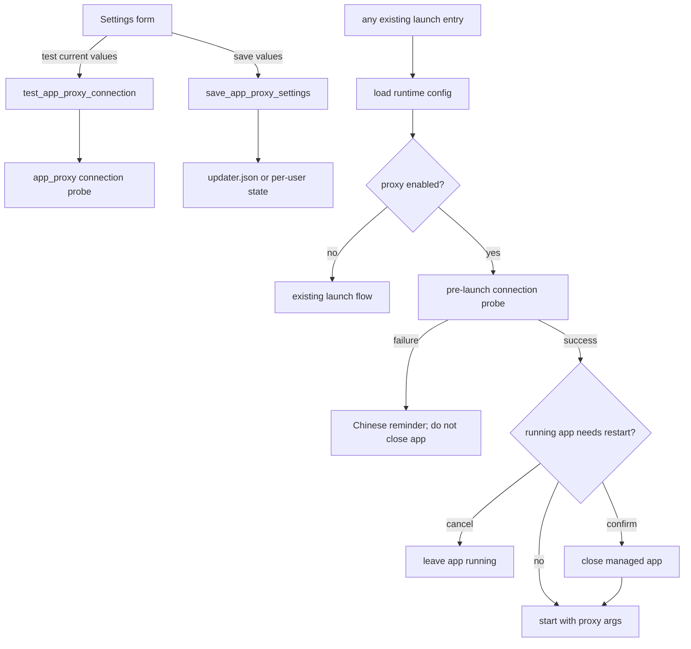

# Integrate application proxy into the Chinese assistant

**Status:** Accepted

**Date:** 2026-10-28

## Decision

Integrate the application-proxy capability from `codex-app-proxy` into the
existing Rust/Tauri launcher. The assistant remains the only user-facing
launcher and configuration surface. The standalone C++ launcher, CMake build,
offline HTML wizard, and separate portable package are not part of the merged
product.

The feature is optional. Existing installations keep their current launch
behavior because the proxy is disabled when the new configuration field is
absent.

## User-visible behavior

The Settings view gains an Application proxy section with:

- an enable switch;
- HTTP/mixed and SOCKS5 protocol selection;
- host and local port fields;
- presets for V2RayN, Clash Verge Rev, Clash/Mihomo, and generic SOCKS5;
- a manual connection test;
- a QUIC toggle and Chromium bypass list under advanced settings;
- save feedback and a visible unsaved-changes state.

The connection test uses the current form values and never saves them. Starting
an application uses the saved values only. A successful test means that the
assistant connected to the configured proxy host and port; it does not claim
that a remote node or ChatGPT is reachable.

When the proxy is enabled, a failed pre-launch connection check blocks that
launch and shows a Chinese recovery message. The check happens before any
managed application is closed. If the target application is already running,
the assistant asks for a full restart before applying new Chromium proxy
arguments. Cancelling the restart leaves the running application untouched.

The following existing entry points all use the same saved proxy settings:

- latest-version launch from the overview;
- selected historical-version launch;
- post-install launch;
- the desktop shortcut helper that launches the latest version.

## Scope boundaries

This feature configures proxy arguments for the managed ChatGPT/Codex desktop
application only. It does not change the Windows system proxy, create a TUN
adapter, start a proxy service, configure proxy nodes, or apply the setting to
Microsoft Store downloads, GitHub requests, or the terminal Codex CLI.

Proxy credentials are outside this feature. The first version accepts a host
and port only.

## Architecture

The existing `proxy` module continues to own version resolution, process
switching, singleton handling, and process launch. A new `app_proxy` module
owns proxy configuration, validation, connection probing, and Chromium argument
construction. The name distinguishes network proxying from the existing
"proxy-mode" launcher behavior.



### Configuration

Add an optional `app_proxy` object to the existing `Config` model. Missing
objects deserialize to the disabled default, preserving old `updater.json`
files.

```json
{
  "app_proxy": {
    "enabled": false,
    "type": "http",
    "host": "127.0.0.1",
    "port": 10808,
    "disable_quic": true,
    "bypass_list": [
      "<-loopback>", "localhost", "127.0.0.1", "::1",
      "10.*", "172.16.*", "192.168.*"
    ]
  }
}
```

The implementation keeps the complete default bypass list from the reference
launcher. It validates a non-empty host, a port from 1 through 65535, and
rejects a full URL or path in the host field. IPv6 hosts are formatted with
brackets when constructing a proxy URL. The bypass list is passed using
Chromium's semicolon-separated syntax and is not silently replaced when the
user explicitly edits it.

Portable and current-user installations save the field in `updater.json`.
System installations save mutable proxy state in the existing per-user state
file, so one user's proxy cannot become a shared Program Files default. Update
and settings writes must merge the latest runtime configuration and preserve
the proxy object.

### Backend API

Expose these Tauri commands and structured results:

- `get_app_proxy_settings()` returns the effective saved settings.
- `save_app_proxy_settings(request)` validates and persists settings, returning
  the saved value.
- `test_app_proxy_connection(request)` probes the supplied values without
  persisting or launching anything.

Connection results distinguish invalid configuration, DNS/host resolution
failure, connection refusal, timeout, and success. The probe has a three-second
total budget and runs outside the runtime configuration lock. The same probe
implementation is used by the manual test and the pre-launch check.

Chromium arguments are built as an argument vector, never as a shell command:

```text
--proxy-server=http://127.0.0.1:10808
--proxy-bypass-list=<...>
--disable-quic
```

SOCKS5 uses `socks5://`. All proxy arguments are omitted when the feature is
disabled.

### Launch semantics

The saved proxy configuration is checked after resolving the target version but
before closing any running managed processes. With the proxy enabled, an
already-running target version cannot simply be focused because Chromium reads
proxy arguments only during the first process start. The launch result therefore
has an explicit restart-required state, allowing the frontend to request
confirmation and then rerun the check before closing processes.

An external installation holding the Chromium singleton is reported as an
external-running-app condition. The assistant must not report proxy success by
silently focusing that installation.

## Testing contract

The implementation is complete only when these behaviors are covered without
requiring an installed third-party proxy or public network access:

1. Old configuration files load with proxy disabled; save and reload preserves
   all proxy fields.
2. Invalid hosts, ports, full URLs, IPv6 hosts, HTTP, SOCKS5, QUIC, and bypass
   list serialization have unit coverage.
3. A local temporary TCP listener proves successful connection testing;
   refused, timeout, and resolution failures return structured Chinese-facing
   states.
4. The frontend tests that unsaved values are tested, test results clear after
   edits, late responses cannot overwrite newer form state, and saving is
   separate from testing.
5. Launch tests prove that an unavailable proxy prevents launch and process
   shutdown, while a successful probe supplies the expected Chromium arguments.
6. Existing latest, historical, post-install, and desktop-shortcut launch paths
   retain their behavior with proxy disabled.
7. System-install tests prove that a per-user proxy setting survives updates and
   is not written as a shared install-root default.

Windows acceptance additionally checks HTTP/mixed and SOCKS5 startup, the
restart confirmation when the app is already running, failure messaging with
the proxy software stopped, and the existing minimum window size.

## Implementation order

1. Add the Rust configuration types, validation, probe, and argument builder;
   add focused unit tests.
2. Add runtime configuration commands and merge-safe persistence for all install
   modes.
3. Integrate pre-launch checking, restart confirmation, and argument passing in
   every existing launch entry point.
4. Add the settings UI, presets, asynchronous test state, and launch-status
   feedback.
5. Update product documentation and run the existing Rust, frontend, lint,
   build, and release-package checks.

## Consequences

The assistant becomes the single source of truth for managed application
launching and proxy settings. The standalone proxy project's C++ code remains a
reference for behavior and test cases, while the merged implementation follows
the Rust/Tauri architecture and existing release artifact contract.
